# Практическое задание 9. Git
## Задание на оценку 3
---
### 1. Текущая ветка:
`git status`
В текущий момент нахожусь в ветке main
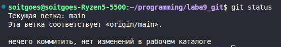

### 2. git log:
История коммитов репозитория (от новых к старым)
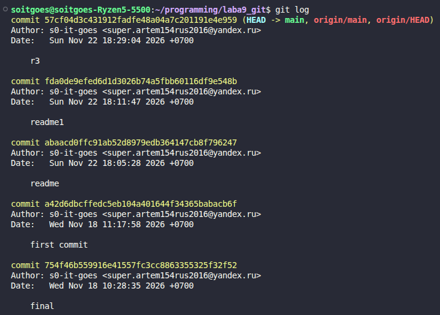

### 3. Создадим файл sort.c и добавим сортировку пузырьком:
```
void bubble_sort(int arr[], int n) {
    for (int i = 0; i < n - 1; i++) {
        int swapped = 0;
        for (int j = 0; j < n - 1 - i; j++) {
            if (arr[j] > arr[j + 1]) {
                int tmp = arr[j];
                arr[j] = arr[j + 1];
                arr[j + 1] = tmp;
                swapped = 1;
            }
        }
        if (!swapped) {
            break;
        }
    }
}
```

### 4. git status:
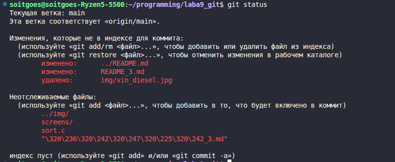
*в git status также попали мои прошлые изменения, которые я не закоммитил*

### 5. Добавим файл с сортировкой в область stage(add):
`git add sort.c`

### 6. git status:
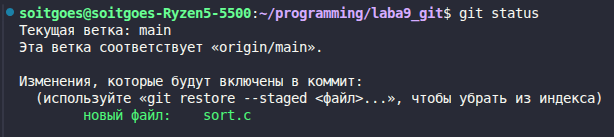
**теперь отображается, что файл попал в область индексации и будет включен в коммит, также предлагает убрать его из индекса**

### 7. Коммит в репозиторий:
`git commit -m "added sort.c"`
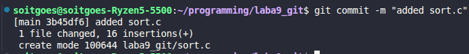

### 8. git status:
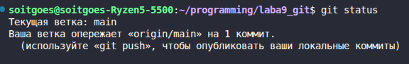

### 9. Добавим комментарий с любым текстом в тот же файл:
`// комментарий с любым текстом в sort.c`

### 10. git status:
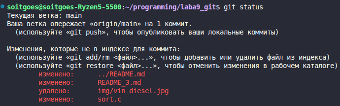


### 11. git add для измененного файла:
`git add sort.c`

### 12. git status:
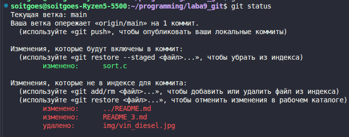

### 13. Изменим файл еще раз
Добавим ещё один комментарий: `// ещё один комментарий`

### 14. Сделаем коммит
`git commit -m "commit"`

### 15. git status и git log:
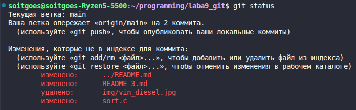
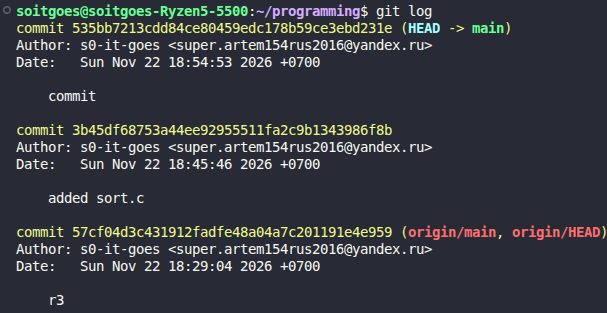
**В git log появились два новых коммита, которые я сделал ранее, а git статус оповещает, что моя локальная ветка опережает основную на 2 коммита**

### 16. Добавим в stage и закоммитим последнее изменение:
`git add sort.c`
`git commit -m "last change"`

### 17. Запушим на удалённый репо:
`git push`


# Ветки

### 1. Создадим новую ветку с именем mybranch
*также сразу на нее переключимся, флаг -b создаёт ветку, если ее нет*
`git checkout -b mybranch`

### 2. git branch:
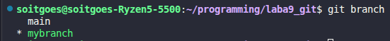

### 3. Переключимся на новую ветку
*т.к. я использовал для создания ветки `git checkout -b mybranch`, то после `git switch mybranch` выведется сообщение, что мы уже находимся на этой ветке*

### 4. git status:
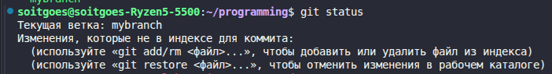
**`git status` показывает на какой ветке мы находимся**

### 5. Убедимся, что находимся на ветке mybranch, прежде чем продолжить
`git branch`

### 6. Создадим файл с именем file1.txt и своим именем
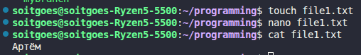

### 7. Добавим файл и закоммитим изменение
`git add file1.txt`
`git commit -m "file1.txt"`
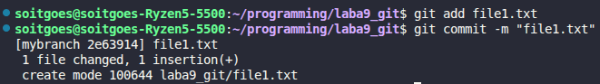

### 8. Проверим, указывает ли наша ветка на новый коммит
`git --oneline --graph`
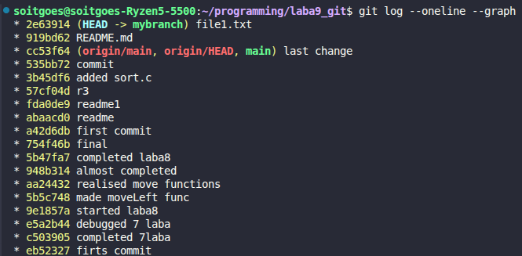
**Наша ветка указывает на новый коммит, который имеет описание file1.txt**

### 9. Вернемся к ветке с именем master(main) и проверим, на какой ветке находимся:
`git switch main`
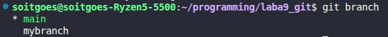

### 10. Используем git log чтобы посмотреть, что изменилось:
`git log --oneline --graph`
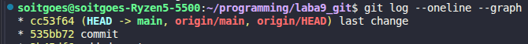

### 11. Создадим новый файл file2.txt и закоммитим его:
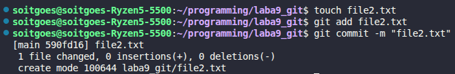

### 12. Убедимся, что наша ветка указыввает на новый коммит:
`git log --oneline --graph --all`
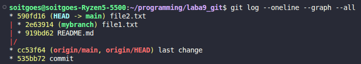
**Теперь две наши ветки указывают на разные коммиты**

### 13. Переключимся на ветку mybranch:
`git switch mybranch`

### 14. Пропажа файла
Теперь наш файл file2.txt пропал, потому что мы переключились на другую ветку, в которой этот файл не существует, т.к. в этой ветке мы его не коммитили

### 15. Посмотрим на разницу между ветками:
`git diff mybranch main`
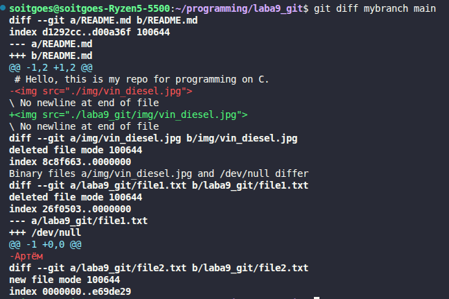
*В git diff попали так же изменения, которые не относятся к этой лабе, прошу прощения!*
**Видно, что в ветке main есть file2.txt, но нет file1.txt, соответственно так же для mybranch, где есть file1.txt, но отсутствует file2.txt**

### 16. Закоммитим файл с отчётом и скриншотами
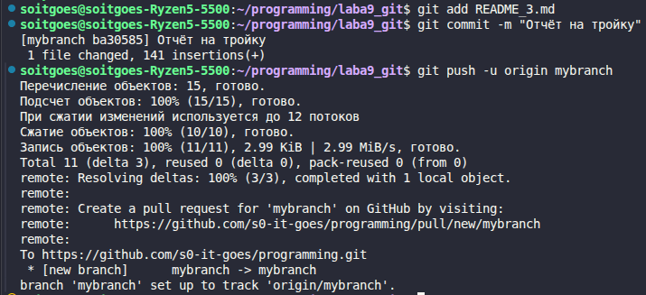

### 17. Убедимся, что на гитхабе есть 2 ветки:
Действительно, на гитхаб отображаются две ветки: main и mybranch
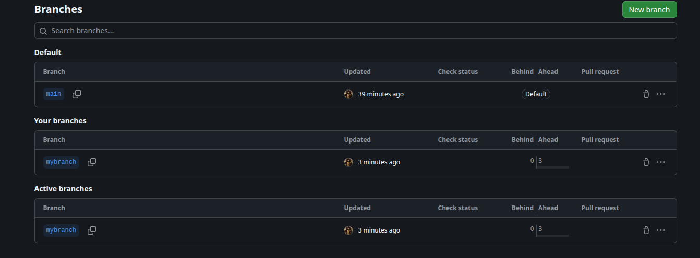