# Практическое задание 9. Git
## Задание на оценку 4

### 1. Переключимся на ветку mybranch:
`git switch mybranch`

### 2. Добавим в функцию main код:
```
int main()
{
    int a[] = {4, 2, 0};
    bubble_sort(a, 3);

    return 0;
}
```

### 3. git diff:  
*git diff показывает изменения в рабочей папке, которые еще не добавлены в staged*  
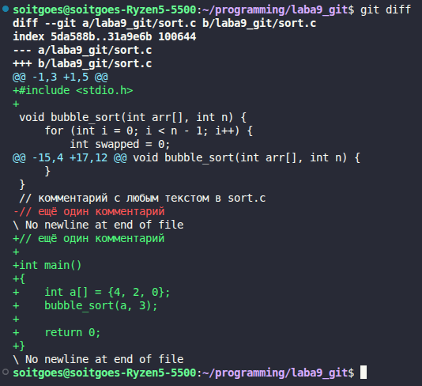    
**В данном случае git diff показывает что мы добавили в sort.c**

### 4. git diff --staged:
Пустой, ничего не выведено на экран  

### 5. Добавляем в staged sort.c
`git add sort.c`  

### 6. git diff:
Теперь тоже пустой  

### 7. gid diff --staged:
Теперь показыват то, что было в `git diff` до того, как добавили sort.c в staged  
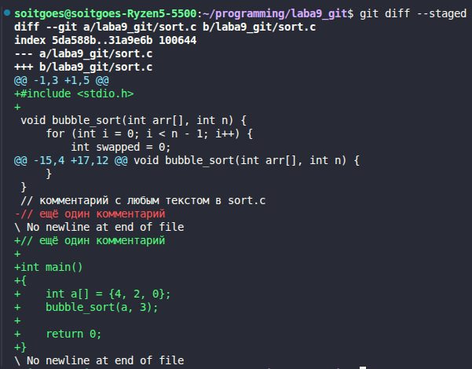  

### 8. Удалим любое из чисел в массиве в sort.c:
```
int main()
{
    int a[] = {4, 2};
    bubble_sort(a, 2);

    return 0;
}
```  

### 9. git diff:
Теперь отображает изменения в файле sort.c  
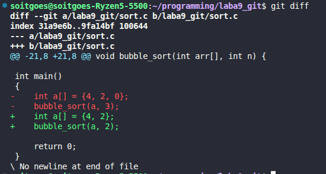  

### 10. git diff --staged:
Здесь без изменений  
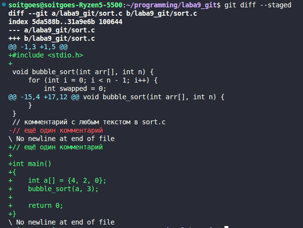  

### 11. Объяснения
В `git diff` отображаются изменения в рабочей папке, которые еще не добавлены через git add, а в git diff --staged показывают изменения в индексе, которые войдут в следующий коммит. Соответственно, добавив в staged в первый раз изменения в sort.c, они пропадают из `git diff` и появляются в `git diff --staged`  

### 12. git status:
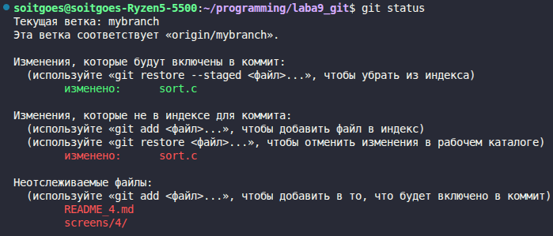   
**Действительно, sort.c присутствует два раза, т.к. первые изменения мы закоммитили, а вторые не добавили в staged**

### 13. Отменим индексацию изменения
`git restore --staged sort.c`  
**Убрали из индекса информацию об изменениях после последнего коммита**

### 14. git status:
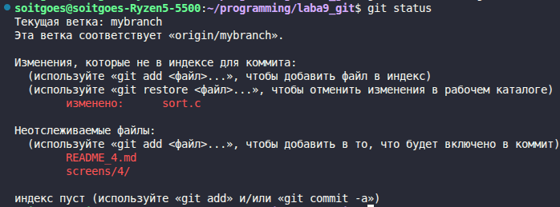   
**Второй sort.c пропал**

### 15. Проиндексируем изменение и сделаем коммит
`git add sort.c`  
`git commit -m "indexed"`  

### 16. Журнал:
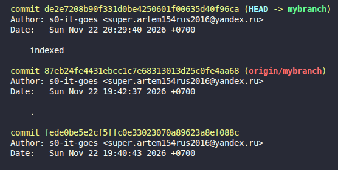
**В журнале появился коммит**

### 17. Добавим printf в sort.c:
```
int main()
{
    int a[] = {4, 2};
    bubble_sort(a, 2);

    print("hello git\n");

    return 0;
}
```

### 18. Содержимое sort.c:
```
#include <stdio.h>

void bubble_sort(int arr[], int n) {
    for (int i = 0; i < n - 1; i++) {
        int swapped = 0;
        for (int j = 0; j < n - 1 - i; j++) {
            if (arr[j] > arr[j + 1]) {
                int tmp = arr[j];
                arr[j] = arr[j + 1];
                arr[j + 1] = tmp;
                swapped = 1;
            }
        }
        if (!swapped) {
            break;
        }
    }
}
// комментарий с любым текстом в sort.c
// ещё один комментарий

int main()
{
    int a[] = {4, 2};
    bubble_sort(a, 2);

    print("hello git\n");

    return 0;
}
```

### 19. git status:
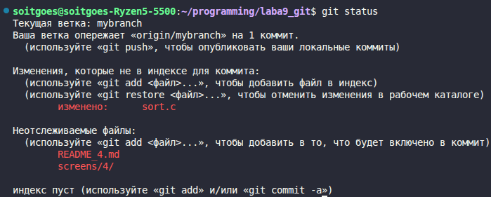  

### 20. git restore:
`git restore sort.c`  

### 21. Содержимое sort.c:
```
#include <stdio.h>

void bubble_sort(int arr[], int n) {
    for (int i = 0; i < n - 1; i++) {
        int swapped = 0;
        for (int j = 0; j < n - 1 - i; j++) {
            if (arr[j] > arr[j + 1]) {
                int tmp = arr[j];
                arr[j] = arr[j + 1];
                arr[j + 1] = tmp;
                swapped = 1;
            }
        }
        if (!swapped) {
            break;
        }
    }
}
// комментарий с любым текстом в sort.c
// ещё один комментарий

int main()
{
    int a[] = {4, 2};
    bubble_sort(a, 2);

    return 0;
}
```  
**Пропал printf**  

### 22. git status:
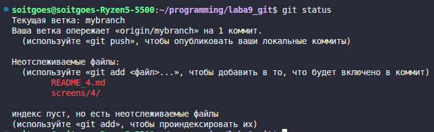  

### 23. Запушим ветку на удалённый репо:
`git add .`  
`git commit -m "commited"`  
`git push`  

# Ветки и ff-merge

### 1. greeting.txt  
`touch greeting.txt`  
`git add greeting.txt`  
`git commit -m "Add file greeting.txt"`  

### 2. Добавим hello в greeting.txt
`echo "hello" >> greeting.txt`  
`git add greeting.txt`  
`git commit -m "Add content to greeting.txt"`  

### 3. Создадим ветку feaute/uppercase  
`git branch feature/uppercase`  

### 4. Переключимся на новую ветку  
`git switch feature/uppercase`  

### 5. git status:  
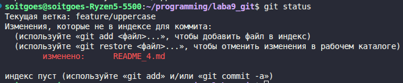  

### 6. Сделаем HELLO:
`echo "HELLO" > greeting.txt`  

### 7. Коммит:
`git add greeting.txt`  
`git commit -m "HELLO"`  

### 8. git branch:  
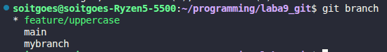   
**Показывает, что есть 3 ветки и мы находимся на ветке feature/uppercase**  

### 9. git log --oneline --graph --all:  
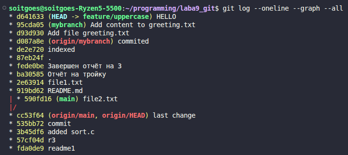   

### 10. Переключаемся на главную ветку  
*Файл README_4.md временно кладу в стэш командной `git stash`*  
`git switch main`  

### 11. Содержимое файла
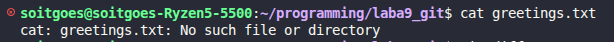   
**Файла не существует в этой ветке, что логично, поскольку работали с ним мы в ветке feature/uppercase**

### 12. Сравнение веток
`git diff main feature/uppercase`  
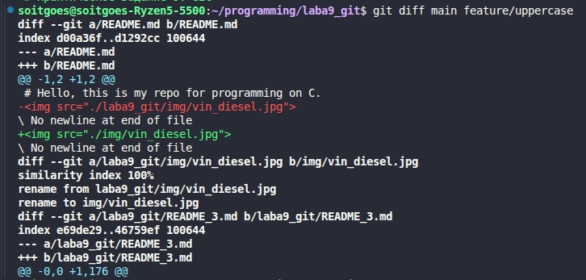  
**К сожалению, поместилось не все и не видно, что в различиях есть greeting.txt, его будет видно дальше при git merge**  

### 13. Объединение веток
`git merge main feature/uppercase`  
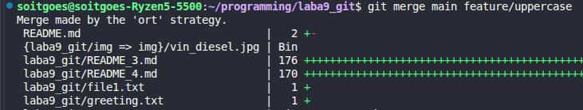  
**Теперь видно, что при слиянии добавился файл greeting.txt**  

### 14. Содержимое файла greeting.txt
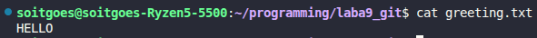  

### 15. Удаление ветки  
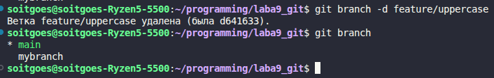  
**Теперь осталась основная ветка main и созданная нами ранее ветка mybranch**  

### 16. Сливаем ветки mybranch и main
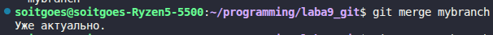  
**Логично, поскольку ранее мы уже слили ветку feature/uppercase с main, которая унаследовала изменения mybranch**

### 17. Журнал изменений
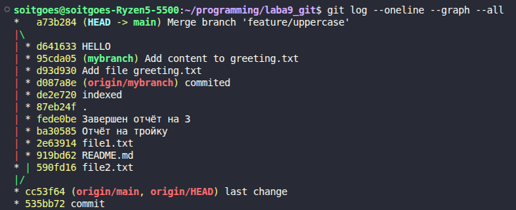  
**Отображается где мы отошли от основной ветки, и где вернулись на нее**