# Практическое задание 9. Git
## Задание на оценку 5

### 1. Создание ветки branch1
```
git checkout -b branch1
```

### 2. Выполним команду
```
echo "This is a relevant fact" > file.txt
```  
**Она через перенаправление потока вывода создаёт file.txt и записывает в него сообщение из echo**  

### 3. Закоммитим это изменение
```
git add .
git commit -m "file.txt"
```

### 4. Создание такого же файла на ветке main
```
git switch main
echo "This is an indispensable truth!" > file.txt
```

### 5. Коммитим изменение в master
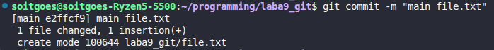  

### 6. Журнал изменений
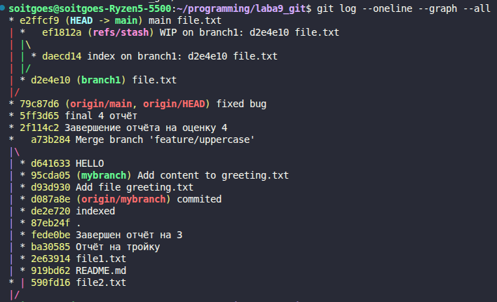  

### 7. Пробуем слить ветки
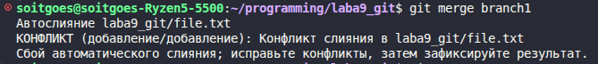  
**Получаем конфликт, поскольку в обоих ветках есть file.txt с разным содержимым на одних и тех же строках**  

### 8. git status:
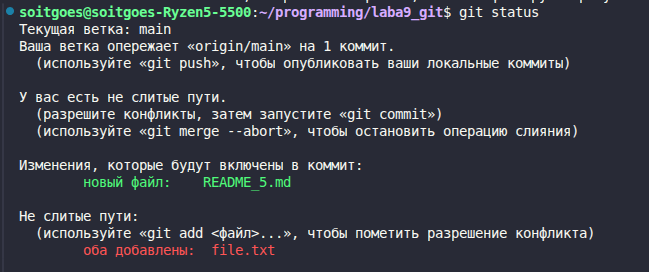  

### 9. Содержимое файла file.txt
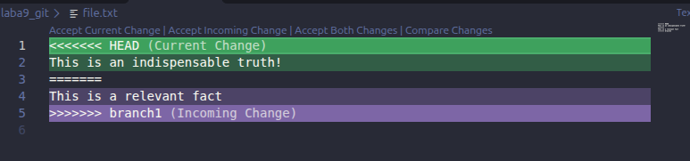  
**Отображается в каком месте у нас merge conflict, чтобы исправить, ножно убрать маркеры конфликта (<<<<<<<, ========, >>>>>>>), исправить файл и оставить только нужный текст, после этого закоммитить**

### 10. Журнал изменений
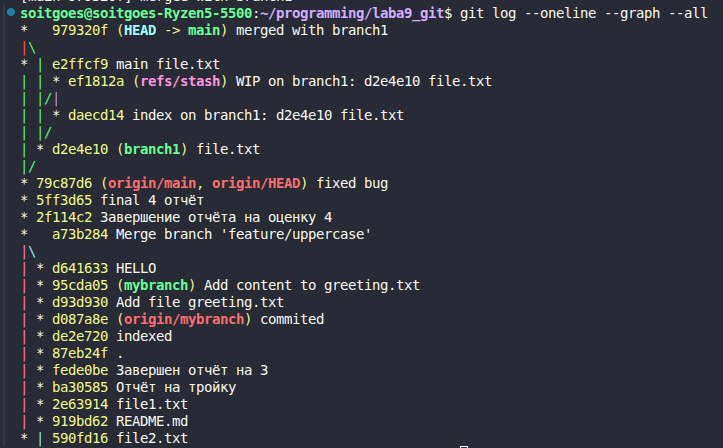  
**Отображается, что мы смержили main с branch1**

### 11. Запушим изменения
```
git push
```

# Merge конфликты для сортировки MergeSort на python.

### 1. Создадим `megesort.py`
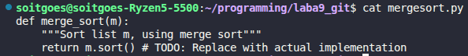  

### 2. Проиндексируем файл и закоммитим
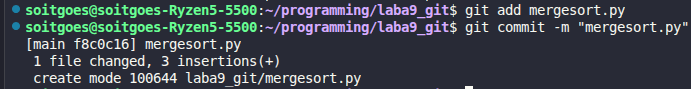  

### 3. Создадим ветку Mergesort-Impl и переключимся на неё
```
git checkout -b Mergesort-Impl
```

### 4. Заменим код из `mergesort.py`
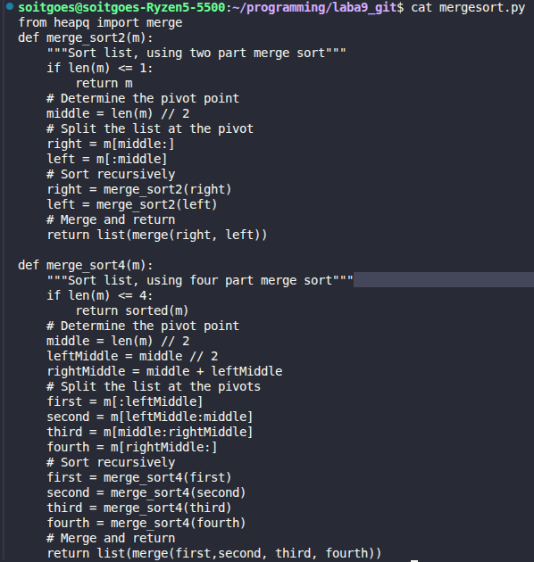  

### 5. Коммитим изменения
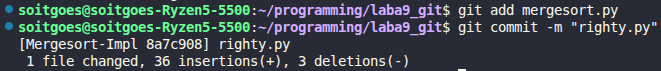  

### 6. Переключаемся на master и меняем все содержимое `mergesort.py` на `lefty.py`
```
git switch main
```   
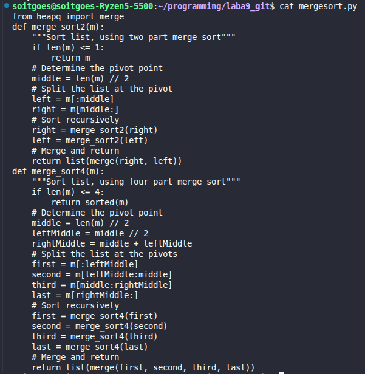  

### 7. Коммитим изменения
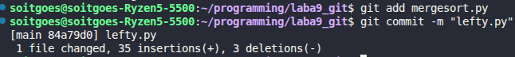  

### 8. Журнал изменений
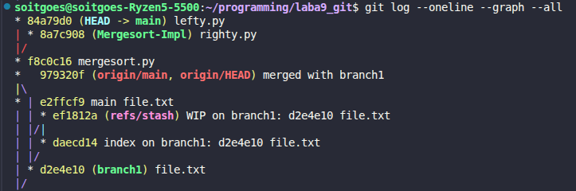  

### 9. git branch
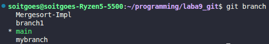  

### 10. Пробуем смержить Mergesort-Impl в main
```
git merge Mergesort-Impl
```  
**Получаем кучу merge-конфликтов**  
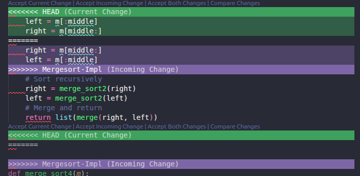  

**Исправляем конфликт, вручную удаляя ненужные части кода. Я решил оставить реализацию из Mergesort-Impl**  

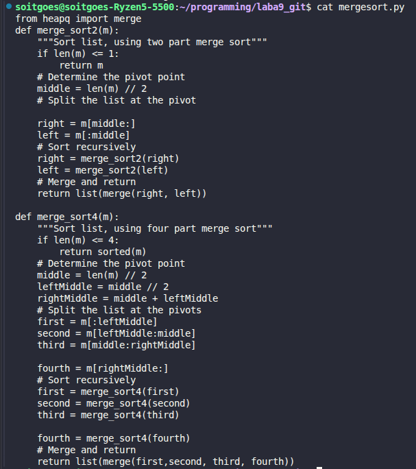  

### 11. Запушим в master изменения
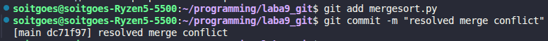  
```
git push
```

### 12. Запушим документ с результатом работы
```
git add .
git commit -m "отчёт 5"
git push
```  